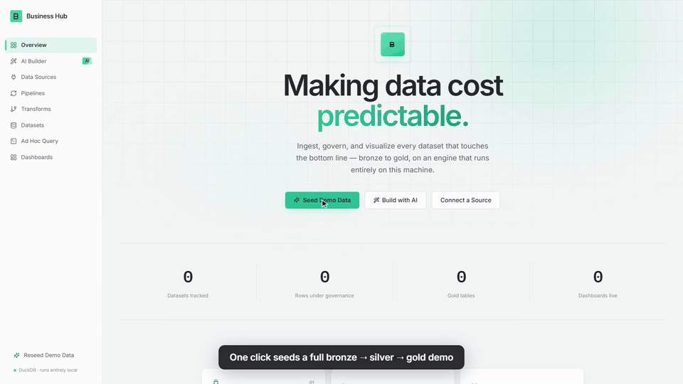

# Business Hub

**Making data cost predictable.**

A standalone, governed data lake with medallion architecture (bronze → silver →
gold), a DuckDB query engine, ingestion pipelines, SQL transforms, and a fully
animated, drag-and-resize dashboard builder — all running locally, no external
services required.



▶️ **[Watch the full demo video (85s)](docs/demo.mp4)**

## Stack

- **Backend**: FastAPI (sync endpoints) + DuckDB (single embedded file, doubles
  as both the app's catalog and the data warehouse itself) + sqlglot (read-only
  SQL validation) + httpx (SSRF-safe outbound requests for API sources).
- **Frontend**: React 18 + Vite + Tailwind + Framer Motion + Recharts +
  react-grid-layout. Built once into static files — the running app needs only
  Python, not Node.

No Docker, no Postgres, no Redis, no message broker required to get started.
Real data warehouses (BigQuery, Athena) and message queues (SQS, Pub/Sub) are
supported as *integration types* when you want to point at one.

## Running it

```bash
python run.py
```

That's the whole thing — first run creates the backend venv, installs
dependencies, builds the frontend, starts the server, and opens
**http://127.0.0.1:8420** in your browser. Later runs just start the server
(it detects what's already set up). Ctrl+C to stop.

Other useful commands:

```bash
python run.py start --seed     # start, then seed mock demo data once it's up
python run.py setup            # (re)install deps + rebuild the frontend, without starting
python run.py build            # rebuild the frontend only
python run.py dev              # backend + Vite dev server together, for live-reloading frontend work
python run.py reset            # delete local DuckDB/SQLite data files (asks first)
```

Prefer to run it by hand instead of through `run.py`:

```bash
cd backend
python -m venv .venv && .venv\Scripts\activate      # Windows; source .venv/bin/activate elsewhere
pip install -r requirements.txt
cd ../frontend && npm install && npm run build
cd ../backend && python main.py
```

On first run, the app has no data. Click **"Seed Demo Data"** (sidebar or
homepage) to populate it with a full mock medallion chain:

- A synthetic SQLite "orders" database (650 rows) as a database source
- JSONPlaceholder's public `/users` endpoint as an API source
- A silver transform cleaning and typing the orders
- Five gold aggregate tables (revenue by category, orders by status, revenue
  by customer, monthly trend, revenue by city)
- An "Executive Overview" dashboard with 9 widgets, fully editable

Re-running the seed is idempotent — it updates existing rows rather than
duplicating them.

## Data sources

**Pull sources** (an ingestion pipeline fetches on demand or you click "Run
Now"): SQLite, PostgreSQL, Google BigQuery, AWS Athena, and REST APIs. The
API integration type supports the full configuration a real API is likely to
need: GET or POST, bearer/basic/API-key/OAuth2-client-credentials
authentication, arbitrary default headers and query parameters, pagination
(page-number or cursor), TLS verification toggle, and per-request timeout.

**Push / streaming sources** (data arrives on its own, no "run" step):

- **Webhook** — each pipeline gets a stable endpoint at
  `POST /api/ingest/webhook/{pipeline_id}`, secured by a shared secret sent
  as `X-Webhook-Secret`. Post a JSON object or array of objects; each call
  *appends* to the bronze table rather than replacing it. The endpoint URL
  is shown on the pipeline's own page once it's saved.
- **AWS SQS** / **GCP Pub/Sub** — start a pipeline from the pipelines list
  and a background thread long-polls the queue/subscription, appending each
  message as it arrives, for as long as the app is running. Stop it the same
  way. If the app restarts while a stream was active, it resumes
  automatically on the next startup.

## AI Builder

**AI Builder** (sidebar) turns bronze tables into a full medallion model:
pick tables, optionally describe what you want to learn, and the AI designs
silver transforms, gold aggregates, and a dashboard.

Nothing is created blindly. Every transform and widget query is dry-run
inside a DuckDB transaction that is always rolled back. If any SQL fails,
the error goes back to the model, which repairs its own plan (up to two
rounds). You then review the flow and a live-data preview of the dashboard
before clicking **Create everything**. All generated SQL still passes
through the same read-only `sql_guard` as user-written queries.

The provider is your choice (the settings button on the AI Builder page):

- **Anthropic (Claude)** through the official SDK. Default model
  `claude-opus-5-5`. Uses a key saved in settings, or `ANTHROPIC_API_KEY`.
- **Any OpenAI-compatible API**: OpenAI, Groq, OpenRouter, Google Gemini,
  or a custom endpoint. Ollama and LM Studio run fully on your machine.

What gets sent: column names, types and summary stats for the selected
tables, plus min/max values and 5 sample rows unless you untick "Share
sample values". Keys are stored in the local DuckDB catalog and never
returned to the browser.

## Frontend development

For live-reloading frontend work:

```bash
cd backend && python main.py        # terminal 1 — API on :8420
cd frontend && npm run dev          # terminal 2 — Vite dev server on :5173, proxies /api to :8420
```

Work against `http://localhost:5173` during development. When done, `npm run
build` regenerates `frontend/dist/`, which `main.py` serves directly — no
need to keep the Vite dev server running for normal use.

## Architecture notes

- **DuckDB is both catalog and warehouse.** Tables prefixed `_` (`_integrations`,
  `_pipelines`, `_transforms`, `_datasets`, `_saved_queries`, `_dashboards`,
  `_widgets`) hold app metadata; everything else (`bronze_*`, `silver_*`,
  `gold_*`) is real ingested/transformed data, queryable directly.
- **Every user-supplied SQL statement is AST-validated** (`sql_guard.py`,
  via `sqlglot`) before it runs — only single read-only `SELECT`s against
  known non-catalog tables are allowed. Catalog tables are structurally
  invisible to transforms/queries, so a transform can never read another
  integration's stored credentials.
- **A single `threading.Lock()`** serializes all DuckDB access, since FastAPI
  runs sync endpoints in a thread pool. Slow external I/O (HTTP calls, source
  DB reads) happens *outside* the lock; only the final DuckDB write is
  guarded.
- **Outbound API requests are SSRF-guarded** (`http_safety.py`) — every host
  is resolved and checked against private/loopback/link-local ranges before
  connecting, re-checked on every redirect hop.
- **Streaming pipelines run as daemon threads inside the same process**
  (`streaming.py`) — one thread per active SQS/Pub/Sub pipeline, tracked in
  an in-memory registry. They write through the same `append_rows_to_table`
  path a webhook call uses. No separate worker process or message broker.

## Data location

Everything lives under `data/` at the project root: `business_hub.duckdb`
(the whole app's state) and `mock_orders.sqlite` (the demo source database).
Delete both and restart to reset to a truly empty state (or use the "Reseed
Demo Data" button, which is idempotent and safe to run repeatedly).

## License

[MIT](LICENSE): free to use, modify and share. Contributions, issues and ideas are welcome.
